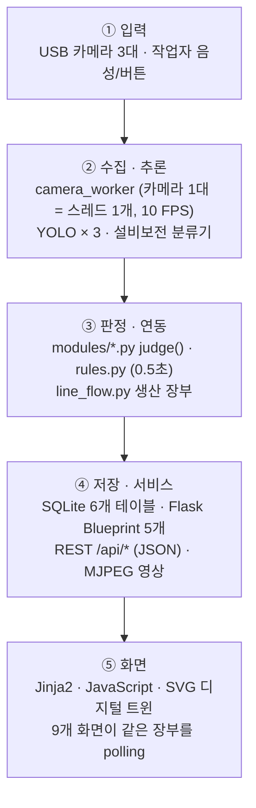

# SMART LINE MES

**AI 4종과 MES를 하나의 작업라인으로 묶은 관제 웹**

작업라인의 손실은 사람(안전), 제품(품질), 설비(보전) 세 곳에서 함께 생깁니다.
SMART LINE은 비전 AI 3종과 자연어 AI 1종의 판정을 한 서버, 한 DB, 한 생산 장부로 모아
9개 화면이 모두 같은 숫자를 보도록 만든 미니 MES입니다.

| 항목 | 내용 |
|---|---|
| 과정 | 대한상공회의소 부산인력개발원 AI 스마트제조 융합인재 양성과정 팀 프로젝트 |
| 기간 | 2026.09.29 ~ 10.07 (작업일 7일), 최종 발표 2026.10.08 |
| 팀 | 4명 |
| 기술 | Python 3.12, Flask, SQLite, JavaScript(프레임워크 없음), SVG, OpenCV, Ultralytics YOLO, PyTorch, TensorFlow, scikit-learn, uv |

---

## 역할 분담

| 담당 | 맡은 부분 |
|---|---|
| **김영창 (팀장)** | **전체 통합 구조 설계, MES 웹(서버 · DB · 9개 화면), 디지털 트윈, 연동 규칙, ④ 설비보전 AI** |
| 김태원 | ① 안전게이트 모델 (YOLOv8n) |
| 유장오 | ② 프레스 안전 모델 (YOLO11s) |
| 백임수 | ③ 품질검사 모델 (YOLOv8) |

| AI | 하는 일 |
|---|---|
| ① 안전게이트 | 안전모 · 조끼 · 장갑이 2초 연속 보이면 입장 |
| ② 프레스 안전 | 금형부 위험구역에 손 · 공구가 들어오면 즉시 정지, 경고 구역은 알림 |
| ③ 품질검사 | 캔을 양품 / 흠집 / 찌그러짐으로 판정해 불량 분기 |
| ④ 설비보전 | 고장 보고 문장을 담당 분야 4종 × 조치 시점 3단계로 배정 (TF-IDF+LR · BiLSTM · KLUE 앙상블) |

설비보전 모델의 학습 과정은 [smartline-models](https://github.com/kyc4039/smartline-models)에 따로 정리했습니다.

---

## 시스템 구조



---

## 설계에서 신경 쓴 부분

### 1. 숫자는 서버 한 곳에서 계산한다
품질, 생산, 관제 화면이 불량률 · LOT 실적 · 라인 현황을 각자 계산하면 같은 라인을 두고도 숫자가 달라집니다.
`line_flow.py`가 **검사 기록 1줄 = 상자 1개**로 보고 상자 → 팔레트(8개) → 트럭(10팔레트) → LOT까지 한 번만 계산하고,
화면은 그 값을 그리기만 합니다. 서버와 화면 사이는 REST API로 나눠, 화면을 고쳐도 계산 로직은 건드리지 않습니다.

### 2. 검사 결과가 다음 조치로 이어지게 한다
`rules.py`가 0.5초마다 라인 전체를 확인합니다.

| 규칙 | 동작 |
|---|---|
| 품질 → 보전 | 최근 50개 검사 중 불량률이 3%를 넘으면 정비 요청 알림 |
| 설비 → 라인 | 설비가 하나라도 멈추면 컨베이어도 '연동 정지', 모두 복구되면 자동 재가동 (컨베이어 자체 고장은 자동 해제하지 않음) |
| 보고 → 설비 | 고장 보고가 '즉시 조치'로 분류되면 해당 설비 정지 |

품질 관리 화면에는 p 관리도와 불량 유형 파레토를 두고, 판정 결과를 진짜 불량 / 오판 / 정비 요청으로 나눠 처리합니다.

### 3. 모델을 기다리지 않고 통합한다
팀원들의 모델 학습이 마지막 날까지 이어졌기 때문에, 통합을 모델 완성 뒤로 미룰 수 없었습니다.
카메라 연결 · 영상 전송 · DB 기록 · 화면은 공통 틀(`camera_worker.py`)이 맡고, 팀원은 **모델 파일과 판정 함수 `judge()`만** 넘기도록 나눴습니다.
모델이 없으면 **더미 모드**로 화면과 연동이 계속 돌아가고, 모델이 개선되면 `best.pt` 파일 하나만 바꿔 끼웁니다.

### 4. DB에는 바뀔 때만 기록한다
매 프레임 판정은 메모리(`state.py`)에만 두고, 상태가 바뀐 순간과 검사 1건만 DB에 남겨 DB를 작고 빠르게 유지했습니다.

---

## 화면

| 주소 | 화면 | 보여주는 것 |
|---|---|---|
| `/` | 관제 대시보드 | 페이지별 핵심 숫자, 지금 할 일, 오늘 설비 상태 |
| `/twin` | 디지털 트윈 | SVG 등각 라인 위로 상자 · 로봇 · 팔레트 · 트럭 이동 |
| `/production` | 생산 관리 | LOT · 팔레트 · 트럭, 계획 대비 마감 예측, 정지로 잃은 생산 |
| `/quality` | 품질 관리 | p 관리도, 불량 파레토, 판정 상세, 불량품 처리 |
| `/oee` | 설비 종합 효율 | 가용률 × 성능 × 품질, 손실 폭포, 개선 기회 TOP 3 |
| `/maintenance` | 설비 보전 | 고장 보고 → AI 배정 → 정비 티켓, MTTR · MTBF |
| `/safety` | 설비 안전 제어 | 위험구역 판정, 비상 정지 · 수동 재가동 · 정비 잠금 |
| `/gate` | 안전 게이트 | 보호구 확인 후 입장 |
| `/demo` | 시연 제어판 | 8단계 시연 시나리오 (Shift+D 리모컨) |

---

## 빠른 실행

```bash
git clone https://github.com/kyc4039/smartline-mes.git
cd smartline-mes
uv sync                                   # 처음 한 번 (torch · tensorflow 포함, 5~10분)
cp config_local.example.py config_local.py
uv run app.py                             # http://localhost:5000
```

- 카메라나 모델 파일이 없어도 더미 모드로 전체 화면과 시연이 동작합니다.
- 카메라 없이 입장하려면 게이트 화면의 관리자 우회 입장을 사용합니다. PIN은 `config_local.py`의 `ADMIN_PIN`이며, 교육용 기본값(`0000`)은 실제 환경에서는 반드시 바꿔야 합니다.
- 윈도우 · 맥 단계별 설치, 모델 파일 위치, 문제 해결은 [docs/SETUP.md](docs/SETUP.md)에 있습니다.

---

## 폴더 구조

```
smartline-mes/
├── app.py                    서버 시작 (4줄 흐름, 나머지는 rules.start())
├── config.py                 공통 기준값 (판정 구역 · 불량률 기준 · 정비 계획)
├── camera_worker.py          카메라 공통 틀 (detect → judge → draw → on_change)
├── rules.py                  모듈 간 연동 규칙 (0.5초)
├── line_flow.py · production.py   생산 장부 · LOT 계산
├── analytics.py              설비 상태 구간 → 타임라인 → OEE
├── *_info.py                 화면별 집계 (새 데이터를 저장하지 않고 DB를 다시 읽어 계산)
├── db.py · state.py          SQLite 접근 · 실시간 공유 상태
├── maint_model.py            설비보전 앙상블 분류기
├── modules/                  Flask Blueprint (core · gate · quality · safety · maintenance)
├── templates/ · static/      화면 (twin.js 디지털 트윈, flow.js 장부 polling)
├── tools/                    환경 점검 · 모델 검증 · 시연 데이터 생성
└── docs/                     설치 가이드 · 업데이트 기록
```

---

## 한계와 다음 단계

- **실제 설비 신호와 연결하지 않았습니다.** 설비 정지는 화면과 DB 상태로만 표현합니다. 다음 단계는 PLC 정지 신호 연동입니다.
- **교육장 환경에서만 검증했습니다.** 현장 조명 · 진동에서 같은 판정 성능이 나오는지는 확인하지 않았습니다.
- **단일 서버 · 단일 SQLite 구조입니다.** 쓰기는 잠금 하나로 순서를 보장하며, 여러 라인으로 확장하려면 DB 분리가 필요합니다.
- **사용자 인증은 관리자 PIN 수준입니다.**
